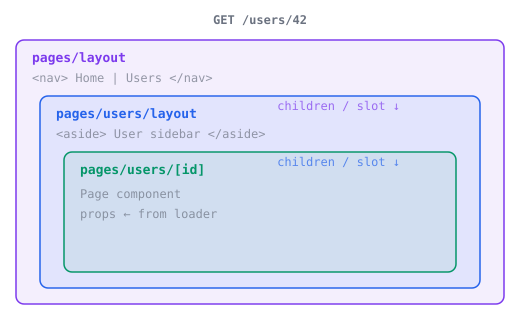

<script setup>
function layoutBasicItems(ext) {
  return [
    {
      name: "pages/",
      children: [
        { name: `layout${ext}`, description: "ルートレイアウト（ナビゲーション、フッター）" },
        { name: `index${ext}` },
        {
          name: "users/",
          children: [
            { name: `layout${ext}`, description: "/users/* 用のネストされたレイアウト" },
            { name: `index${ext}` },
            { name: `[id]${ext}` },
          ],
        },
      ],
    },
  ]
}

function namedLayoutItems(ext) {
  return [
    {
      name: "pages/",
      children: [
        {
          name: "_layouts/",
          children: [
            { name: `landing${ext}`, description: '"landing" という名前' },
            { name: `post${ext}`, description: '"post" という名前' },
          ],
        },
        { name: `layout${ext}`, description: "デフォルトのルートレイアウト" },
        { name: `index${ext}` },
        {
          name: "blog/",
          children: [
            { name: "hello.md", description: "layout: post" },
            { name: "archive.md", description: "layout: landing" },
          ],
        },
        { name: `pricing${ext}`, description: "layout: !landing（排他的）" },
      ],
    },
  ]
}

</script>

# レイアウトと共有データ {#layouts-shared-data}

ナビゲーション、ヘッダー、その他複数のページで共有する UI には、レイアウトを使います。レイアウトはディレクトリに沿ってネストされ、ナビゲーションしてもコンポーネントの状態が保持されます。

## レイアウト {#layouts}

`pages/` ディレクトリにレイアウトファイルを置くと、そのディレクトリのページを包みます。

<FileTree :items="layoutBasicItems" adapter-tabs default-expanded />

::: code-group

```tsx [React]
// pages/layout.tsx
import { useShared, Link } from '@void/react';

export default function Layout({ children }: { children: React.ReactNode }) {
  const { auth } = useShared();
  return (
    <>
      <nav>
        <Link href="/">Home</Link>
        <Link href="/users">Users</Link>
        {auth?.user && <span>{auth.user.name}</span>}
      </nav>
      <main>{children}</main>
    </>
  );
}
```

```vue [Vue]
<!-- pages/layout.vue -->
<script setup lang="ts">
import { useShared, Link } from '@void/vue';
const { auth } = useShared();
</script>

<template>
  <nav>
    <Link href="/">Home</Link>
    <Link href="/users">Users</Link>
    <span v-if="auth?.user">{{ auth.user.name }}</span>
  </nav>
  <main>
    <slot />
  </main>
</template>
```

```svelte [Svelte]
<!-- pages/layout.svelte -->
<script>
  import { useShared, Link } from "@void/svelte";
  let { children } = $props();
  const { auth } = useShared();
</script>

<nav>
  <Link href="/">Home</Link>
  <Link href="/users">Users</Link>
  {#if auth?.user}<span>{auth.user.name}</span>{/if}
</nav>
<main>
  {@render children()}
</main>
```

```tsx [Solid]
// pages/layout.tsx
import { useShared, Link } from '@void/solid';
import type { JSX } from 'solid-js';

export default function Layout(props: { children: JSX.Element }) {
  const shared = useShared();
  return (
    <>
      <nav>
        <Link href="/">Home</Link>
        <Link href="/users">Users</Link>
        {shared.auth?.user && <span>{shared.auth.user.name}</span>}
      </nav>
      <main>{props.children}</main>
    </>
  );
}
```

:::

ページがレンダリングされると、レイアウトがそれを包みます。ページコンポーネントは、React、Solid、Svelte ではレイアウトの children として、Vue ではスロットとして注入されます。



## 名前付きレイアウト {#named-layouts}

名前付きレイアウトを使うと、URL の構造を変えずに、個々のページが別のレイアウトを選択できます。`pages/` 内の `_layouts/` ディレクトリに定義します。

<FileTree :items="namedLayoutItems" adapter-tabs default-expanded />

### 名前付きレイアウトを選択する {#selecting-a-named-layout}

任意のページから `layout` 定数をエクスポートします。

::: code-group

```tsx [React]
export const layout = 'landing';

export default function Page() {
  return <div>This page uses the landing layout</div>;
}
```

```vue [Vue]
<script>
export const layout = 'landing';
</script>

<template>
  <div>This page uses the landing layout</div>
</template>
```

```svelte [Svelte]
<script context="module">
export const layout = "landing";
</script>

<div>This page uses the landing layout</div>
```

```tsx [Solid]
export const layout = 'landing';

export default function Page() {
  return <div>This page uses the landing layout</div>;
}
```

:::

Markdown ページでは、フロントマターを使います。

```md
---
layout: post
---

# My Blog Post
```

### レイアウトモード {#layout-modes}

| 値           | 動作                                                                                       |
| ------------ | ------------------------------------------------------------------------------------------ |
| `"landing"`  | チェーンの最も内側のレイアウトを置き換えます。外側の祖先レイアウトは引き続き適用されます。 |
| `"!landing"` | チェーン**全体**を置き換えます。名前付きレイアウトのみがページを包みます。                 |
| `false`      | レイアウトで一切包みません。ページは単独でレンダリングされます。                           |

名前付きレイアウトは、最も深いデフォルトレイアウトを置き換えます。`[root, docs/layout]` では `docs/layout` を、`[root]` ではルートを置き換えます。

Void は、ページのディレクトリまたはその祖先ディレクトリにある、最も近い一致する `_layouts/` のファイルを使います。名前付きレイアウトが存在しない場合、ビルドは失敗します。

## 共有データ {#shared-data}

ミドルウェアは、`c.set("shared", {...})` を通じて、すべてのページで利用できるデータを注入できます。`CloudContextVariables` を拡張して共有データに型を付けると、`useShared()` が自動的にその型を推論します。

```ts
// middleware/01.auth.ts
import { defineMiddleware } from 'void';
import { getUser, type AuthUser } from 'void/auth';

declare module 'void' {
  interface CloudContextVariables {
    shared: { auth: { user: AuthUser | null } };
  }
}

export default defineMiddleware(async (c, next) => {
  const user = getUser();
  c.set('shared', { auth: { user } });
  await next();
});
```

上記のレイアウトの例のように、フレームワークアダプターの `useShared()` を呼び出します。戻り値の型は `CloudContextVariables` から推論されます。共有データはミドルウェアから、ページの props はローダーから提供されます。[コンテキスト変数](../type-safety.md#context-variables)を参照してください。
