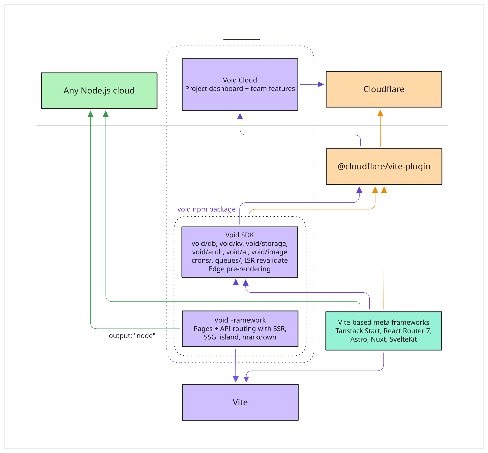

# メタフレームワーク {#meta-frameworks}

フレームワークのルーティングとレンダリングはそのまま使い、データベース、ストレージ、ジョブ、デプロイのために Void を追加できます。このセクションのガイドでは、各フレームワークを Void に接続する方法を説明します。

フレームワークの Vite 設定に `voidPlugin()` を追加してください。リソースの使用状況の検出、データベース型の生成、マイグレーションの管理、`void deploy` のためのアプリの準備を行います。

TanStack Start と React Router は、Void が提供する Cloudflare Vite プラグインを使用します。SvelteKit、Nuxt、Analog、Astro は、それぞれ独自の Cloudflare アダプターを使用します。セットアップは異なりますが、ルーティングとレンダリングは引き続きフレームワークが処理します。



## 対応フレームワーク {#supported-frameworks}

| フレームワーク                        | パッケージ              | 統合方法                                                                                 |
| ------------------------------------- | ----------------------- | ---------------------------------------------------------------------------------------- |
| [TanStack Start](./tanstack-start.md) | `@tanstack/react-start` | Vite プラグインの合成。`voidPlugin()` はフレームワークのプラグインと並べて実行されます。 |
| [React Router v7](./react-router.md)  | `@react-router/dev`     | Vite プラグインの合成。セットアップは TanStack Start と同じです。                        |
| [SvelteKit](./sveltekit.md)           | `@sveltejs/kit`         | Vite ベース。独自の Cloudflare アダプターを使用                                          |
| [Nuxt](./nuxt.md)                     | `nuxt`                  | 独自の CLI とビルドツールチェーン                                                        |
| [Analog](./analog.md)                 | `@analogjs/platform`    | Vite ベース。Cloudflare プリセットの Nitro を使用                                        |
| [Astro **v6+**](./astro.md)           | `astro`                 | 独自の CLI と Cloudflare アダプター（v6 が必要）                                         |

検出は自動です。CLI は `package.json` の依存関係を読み取ります。

## 機能のサポート {#feature-support}

フレームワークの Vite 設定に `voidPlugin()` を追加すると、フレームワークでも [Void アプリ](../../guide/app-types.md#void-apps)とほぼ同じバックエンド/プラットフォーム機能を利用できます。

- **バインディングの推論:** D1、KV、R2、AI、キューは、ソースコードから検出されます。
- **型付きデータベース:** クエリの型は Drizzle スキーマから生成されます。
- **マイグレーション:** 開発の起動時にローカルの D1 が更新され、マイグレーションは検証されて `void deploy` でデプロイされます。
- **ランタイムヘルパー:** `void/db`、`void/kv`、`void/storage`、`void/ai` により、開発と本番で Cloudflare バインディングへ型付きでアクセスできます。
- **認証:** Void 管理の認証は、フレームワークモードではまだサポートされていません。当面は、お使いのフレームワーク向けの Better Auth の公式インテグレーションを使用してください。
- **Cron ジョブ:** `crons/` ディレクトリによるスケジュールハンドラー。
- **キューコンシューマー:** `queues/` ディレクトリによる型付きのプロデューサーとコンシューマー。
- **再検証とプリレンダリング:** `void.config.ts` の [`routing.revalidate`](../../guide/edge/revalidation.md) と [`routing.prerender`](../../guide/edge/prerendering.md) で設定します。Void アプリでは、コンパニオンの `.server.ts` ファイルでページごとに設定することもできます。

フレームワークアプリでは、`void deploy` と `void deploy --platform cloudflare` のどちらでも、Void の再検証は公開 HTML ドキュメントのレスポンスをキャッシュします。クライアントのデータリクエストは、引き続きフレームワーク自身の動作を使用します。`Set-Cookie` を含むレスポンスや、`Cache-Control: private`、`no-store`、`no-cache` のレスポンスが共有されることはありません。

フレームワーク独自の仕組みで、バインディングに直接アクセスすることもできます（例: SvelteKit 3 と Analog では `cloudflare:workers` の `env`、SvelteKit 2 では `platform.env`、Nuxt では `event.context.cloudflare.env`、Astro では `Astro.locals.runtime.env`）。

## 設定 {#configuration}

### `void.config.ts` {#void-config-ts}

ほとんどの設定は自動的に推論されます。デフォルトを上書きしたり動作を細かく調整したりするには、`void.config.ts` を使用します。

```ts
import { defineConfig } from 'void/config';

export default defineConfig({
  inference: {
    build: 'nuxt build',
    scanDirs: ['src', 'server', 'lib'],
    bindings: { db: 'MY_DB' },
  },
  routing: {
    prerender: ['/', '/about', '/pricing'],
    revalidate: 60,
  },
});
```

| フィールド           | 目的                                                                                                                                                                                                         |
| -------------------- | ------------------------------------------------------------------------------------------------------------------------------------------------------------------------------------------------------------ |
| `inference.build`    | デフォルトのビルドコマンドを上書きします                                                                                                                                                                     |
| `inference.scanDirs` | バインディングの推論のためにスキャンするディレクトリ（デフォルトはフレームワークによって異なります）                                                                                                         |
| `routing.prerender`  | デプロイ時に静的 HTML としてプリレンダリングするパス                                                                                                                                                         |
| `routing.revalidate` | キャッシュされたレスポンスのデフォルトの再検証 TTL（秒）                                                                                                                                                     |
| `inference.bindings` | 推論されたバインディングを上書きします。自動検出が意図どおりに動作しない場合にのみ必要です。`true`、または `"db": "MY_DB"` のようなカスタムのバインディング名を指定できます。                                |
| `routing.notFound`   | **無視されます。** SvelteKit、Nuxt、Analog、Astro は `not_found_handling` を `"none"` に固定します。一致しない HTML はフレームワークの Worker が処理します。設定されている場合、`void deploy` は警告します。 |

完全なリファレンスは[設定](../../reference/config.md)を参照してください。

### Cloudflare の設定 {#cloudflare-settings}

Cloudflare の開発ランタイムを使用するフレームワークでは、アダプターが Void の生成する `.void-wrangler.jsonc` を指すようにする必要があります。アダプターのオプションは、各フレームワークのセットアップガイドに記載されています。Cloudflare の設定は `void.config.ts` で定義します。

```ts
import { defineConfig } from 'void/config';

export default defineConfig({
  cloudflare: {
    name: 'my-app',
    compatibility_date: '2026-02-24',
    compatibility_flags: ['nodejs_compat'],
  },
});
```

既存のバインディングは維持されます。D1、KV、R2 は、デプロイまでローカルのプレースホルダー ID を使用します。Cloudflare に直接接続されたプロジェクトでは、`void/ai` をインポートすると、開発中にリモートの Workers AI バインディングが追加されます。使用するには [Cloudflare ログイン](../../guide/ai.md#local-development)が必要です。直接デプロイにも、推論された AI バインディングが含まれます。

Void はこれらの設定を推論されたバインディングと組み合わせ、プロビジョニングされたリソースの ID を `void.lock.json` に記録します。両方のファイルをコミットしてください。

## デプロイ {#deployment}

`void deploy` を実行すると、フレームワークでビルドし、選択したターゲットにデプロイします。セットアップと CI については、[デプロイ](../../guide/deployment.md)を参照してください。
